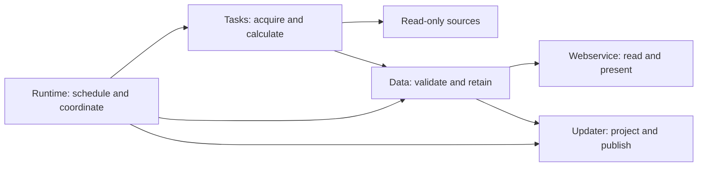

# Architecture

Aranami turns observed Wikipedia project data into reproducible reports,
newsletter facts and read-only web pages. Scheduling, collection, storage and
publication have separate owners. This guide defines their contracts; use
[Development](development.md) for local changes and [Administration](administration.md)
for Toolforge operations.

## Components and dependency direction

| Package | Owns | Does not own |
|---|---|---|
| `runtime` | Scheduling, process lifecycle, source-cycle selection and report coordination | Wiki extraction rules or data schemas |
| `tasks` | Source acquisition, audited wiki rules and reusable calculations | Scheduling, HTML or wiki saves |
| `data` | Schemas, validation, durable stores, disposable caches and publication records | Network collection, scheduling or rendering |
| `updater` | Wikitext projection, bounded edit summaries and intentional destination saves | Source collection or dataset management |
| `webservice` | Saved-data HTTP, HTML, localization and browser behavior | Live source requests, publication or runtime writes |
| `shared` | Configuration, assessment profiles, read-only source adapters and generic text/file primitives | Higher-layer orchestration or project-specific extraction |

`runtime` calls tasks, retains their results through data APIs, then coordinates
outputs. `tasks` may use `data` and read-only `shared.sources`. `data` uses
shared primitives and never imports tasks, runtime or either output package.
The two outputs consume saved/typed data; publication may use Pywikibot only at
its destination boundary. Shared code imports none of the higher layers.
Imports, help, configuration validation and HTTP app construction are inert.



Runtime jobs sequence a complete report pass; they do not contain extractors or
formatters. `tasks.zhwiki` and `tasks.enwiki` own local template and page rules.
The Chinese newsletter belongs to `tasks.zhwiki.newsletter`; its reusable saved
schemas and archives belong to `data.newsletter`. Temporary old-format readers
are isolated under `tasks.zhwiki.legacy` and feed normal data interfaces.

`data.project_data` owns the immutable snapshot contract. `tasks.project_data`
provides the fresh source query; the store invokes the supplied builder only
after acquiring the capture lock and checking for an existing file.
`runtime.project_observations` selects daily versus hourly membership for a
source cycle. The generic cycle accepts this reader without importing runtime.
`data.website` validates the same saved envelope for collection and HTTP reads.

## Daily project observations

One immutable Parquet file represents each wiki, project and completed UTC day:

```text
data/archive/<YYYYMMDD>.parquet  # Chinese wpvg, permanent
data/raw/<project>-<YYYYMMDD>.parquet  # other projects
```

The filename names the day ending at the following midnight. Every new file
comes from a fresh full query; the previous file is only a comparison input.
Collection starts at midnight and finishes afterward. Two adjacent committed
files are required for a daily comparison. Initial captures and gaps do not
establish “no changes.” One-time dates belong only to the
[retirement checklist](transition.md).

Columns retain page identity, namespace/title, subject and talk revision IDs,
project Enum class/importance, talk-page ID, byte length, Boolean redirect
state and List[Enum] taskforces. [Storage](data/storage.md) defines exact types and metadata. Independent projects have their own populations. Taskforce membership stays in
the parent table; Pageviews filters its saved flags without child snapshots.

The scheduled boundary, actual query start and finish are separate facts.
[Wiki Replicas](https://wikitech.wikimedia.org/wiki/Help:Wiki_Replicas) may lag;
the daily collector first waits for heartbeat replication through midnight,
then records the available state without claiming exact historical midnight. Delayed same-day queries retain their actual times. Current
state cannot fill an earlier missing date. Captures crossing into another UTC
day fail instead of being backdated.

Capture uses explicit schema and semantic validation, a wiki/project/date lock,
a content digest, same-filesystem staging, fsync and atomic replacement. The
first complete file wins. Readers reject damaged, unsafe, oversized or mismatched
durable files. Alpha rejects an empty project capture to prevent accidental
mass departures; verified empty-project support requires its own contract.

## Assessments

`shared.assessment_profiles` resolves the exact wiki/project profile, then a
site-wide profile, then preserves unknown observations. Raw PageAssessments
values remain unchanged. Codes, long/short labels, aliases, ordering and article
classification are separate metadata. [Assessment profiles](data/assessments.md)
defines the audited Chinese Video games contract and site defaults.

Namespace 0 does not imply article content: disambiguation and set-index pages
remain non-article classes. Null, empty text, explicit unassessed labels and zero
counts are distinct. Stored Enum declarations preserve observed extra labels;
readers validate the saved declaration and restore it when a Parquet reader
returns String. Decode independent encodings before joining tables.

## Scheduling and source selection

`shared.config` owns scopes, destinations, UTC triggers and website freshness;
`/api/config` exposes that configuration. The collector covers the configured
Chinese parent and Pageviews taskforces. Cross-wiki enrichment keeps its own
observation time. Required datasets commit before a consumer can prepare.

| Work | Trigger and inputs |
|---|---|
| Project data | Every UTC hour :00, first; daily 00:00:00 retains the immutable completed-day observation |
| Assessment log | Daily idle after 00:00; two adjacent committed snapshots |
| Newsletter facts | Daily idle after 00:00 and due retries; daily membership plus retained evidence |
| DYK checks | Hourly :00 in the deferred queue; batch-check revisions and reuse unchanged parses |
| Article evidence | Hourly :00; midnight uses daily membership, later hours may use temporary observations |
| Quality analysis | Hourly idle; shared current membership and retained talk history, with changed article bodies measured in a bounded child process |
| Quality authors | Hourly idle; cached B/BL talk ranges and listing-time attribution in a separate bounded child process |
| Assessment lists and English comparisons | Idle after 00:00, sequentially; daily Chinese membership |
| New-page discovery | Idle after 00:00; hourly retries while behind; independent creation/conversion sources enriched with daily assessments |
| Pageviews | Normally 19:00; hourly :00 retries while behind |
| Website | Every UTC hour :00; startup recovery does not move the next boundary |
| PexBot | Daily idle work; configured subscriptions and 24-hour cooldown |

A source cycle and retries reuse the selected daily dataset. Midnight consumers
obtain it under the capture lock rather than substituting live membership.
Later hourly observations never replace the daily file. Evidence needed by
future reports is retained before its disposable source cache expires.

The primary project collector starts first in each hourly due batch. At midnight
it commits daily observations before retaining the current-hour page list.
Later hours query current membership once per project. Those lists already
contain subject and talk `page_latest` values. One indexed category query per
wiki retains all project category links and complete configured assessment-list
categories, including matching pages outside project membership. Null category
placeholders distinguish known uncategorized pages from uncovered IDs.

Collectors reuse the hourly Parquet, then `newsletter-daily` prepares daily facts,
and only then do deferred report consumers run. Waiting phases occupy no executor
threads. New hourly collection can start while an earlier publication finishes.
Adapters supplement only page IDs or custom categories absent from central
coverage, using read-only replica queries. Daily consumers retain their exact
immutable membership boundary while source revision checks use current-hour
observations. Preview caches remain isolated. Startup recovery never shifts the
hourly cron phase or the next hourly report-freshness bucket.

`new_pages` and `pageviews` remain daily work with conditional hourly retries.
Their normal readiness boundaries stay midnight-idle and 19:00 UTC; both wait
until collection finishes before preparing publication.

DYK and website review/discussion acquisition already batch-check source
revision IDs and parse changed revisions only. These shortcuts retain current
membership, category/template aliases, date-window and destination checks;
unchanged talk revisions cannot justify skipping an entire report pass.

APScheduler coalesces missed triggers and permits one active invocation per
routine. Startup recovers due work unless
`run_immediately=False`; shutdown stops dispatch and drains active work before
closing resources. `runtime.run_once` performs selected work without changing
schedules. A historical report anchor never changes actual observation time or
Pageviews readiness. Output failures are independent: a failed website refresh
does not undo a successful wiki result.

## Retention and publication

`data.reports.ReportStore` retains complete reusable tables, manifests and
wikitext beneath `data/parsed/`. An atomic selector points to a complete
generation and its predecessor. Ordering and predecessor checks prevent stale
work from replacing a newer result. Display limits never discard source rows.

A report pass validates destination settings, prepares facts, retains the full
proposal, rechecks the destination, saves, then records the outcome. Storage
failure blocks publication. Failed or unconfirmed saves retain the proposal and
its baseline digest. Retries must not consume removals or restorations from an
unsaved proposal. Confirmed save, no change, deferral, failure and unknown edit
count remain distinct outcomes.

Preview writes stay under `dry-run/` and cannot advance production datasets,
publication membership, completion evidence or live status. They do not call
wiki save methods or PexBot refresh endpoints. The run summary links flat UTF-8
wikitext companions and retains complete data bundles separately.

## Report contracts

**Assessment changes.** Compare wiki/page IDs with Polars joins. Renames preserve
identity; leaving the project does not prove deletion. Preserve removed rows'
observed namespace/title. Default retention is 30 completed days, configurable
from 1 to 365. Adjacent unchanged files may produce `無變更`; baselines and gaps
may not. Rename-only changes do not become assessment changes. Published
history and unsaved proposal text survive the new comparison baseline.

**DYK.** Candidates and completions are separate. A repeat nomination can appear
in both; only a new completion date proves another pass. Require paired `dyk`,
`dykn`, `dyk-chart-x` and `dyk-chart-y` managed ranges. Charts use comma-space
CSV. Preserve nomination/completion dates and source revisions rather than
assigning collection dates.

**New pages.** Discover creations and `mw-removed-redirect` revisions in each
half-open UTC day, including pages outside project assessments. Apply the same
namespace, redirect and relevance rules to both. Parse every eligible candidate's
source independently of project membership. Assessments enrich class icons only
after discovery. Text filtering uses parsed active prose and verified metadata,
with context for ambiguous keywords. Comments, references, URLs, code and
navigation must not create matches. Deduplicate by page ID, retain timestamps
and conversion notes, and keep the existing output style. Verified game-cover
license and rationale templates establish relevance for file pages. Fill gaps
in the previous calendar month chronologically; explicit `days` can override
retention. Include even-numbered subject namespaces except user pages. Order
articles, drafts, then other pages, sorting each group by responsible registered
user ID and event time. Wait for ordinary scheduled work to finish; retry failed
collection at each hourly boundary while idle and stop until tomorrow after
confirmed completion. Expire old records without refreshing icons alone.

**Pageviews.** Use all-access/user observations from the
[Wikimedia Pageviews API](https://doc.wikimedia.org/generated-data-platform/aqs/analytics-api/reference/page-views.html).
All traffic acquisition and calculation waits until 19:00 UTC, including
historical catch-up. Yesterday additionally requires all 24 distinct site
hours, positive aggregate traffic, the daily top list and up to three leading
article probes. Anchors, previews and cached history cannot bypass readiness.
Retry at :00 while behind; stop catch-up on failed or unconfirmed publication.
Select each report's parent and task-force membership from its completed-day
file: November 2 traffic consumes `20261102.parquet`, captured at the November 3
boundary, even when processed later. Each catch-up date has an independent
source cycle and membership provenance. Missing historical observations block
publication; current membership cannot replace them.

Keep at least the configured 800-day window, extending for comparisons. Reuse a
page only when its dated rows are continuous from the required start; download
its missing tail. Internal gaps, inadequate leading coverage or invalid rows
require a full-window fetch. A successful sparse supplement also triggers a
full-window fetch instead of blocking all articles. Failed downloads preserve
the prior selected dataset. Unknown responses remain unknown. Verified full
batches may use provisional zeroes after the first real observation for ranking, but those
zeroes never become measured traffic rows. No target-day observations fails the
batch. Persist detailed `daily`, frozen `members` and `coverage` Parquet before
publication so newsletters and webservices can reuse it without requests.

Titles, assessments and taskforce flags come from midnight even when traffic
arrives much later. Compare ranks against the prior non-overlapping equal-length
period; unknown rank is not automatically “New.” Calendar-year figures never
use rolling-year totals. The wiki checkpoint is `<!-- report date YYYY-MM-DD -->`;
save missing dates consecutively. HOT/v2 uses one `#invoke:PJ:VG/HOT/v2` JSON
call per list, actual taskforce identities, complete periods and explicit nulls.
Official site ranks cover only the top 1,000, unlike full project rankings.
Catch-up uses its frozen cohort and does not invent historical membership.

**English comparisons and delegated reports.** English grades, Wikidata links
and promotion dates retain their own source times. Stable IDs survive renames.
Quality results order FA/FL/GA by promotion date with unknown years last.
Current FAC/FLC/GAN candidates outside the listed grades appear first under
`参评条目`, with their existing grade and nomination type, ordered by newest
nomination date first. Same-day candidates use English title order, and unknown
dates appear last. Proven nomination starts are separate from promotion dates.
Existing quality members retain their date and ordering while active review
types appear beside their grade, such as
`GA/GAR`. Summaries include the current candidate total on every update, omitting
it only when zero; `GA/FAC` does not count as a new candidate.
Required count/body ranges preserve original baseline evidence. PexBot retains
unknown edit counts, configured roots, a 24-hour cooldown and 15-second spacing.

**Newsletters.** Chinese extraction and issue workflows live under
`tasks.zhwiki.newsletter`. Normal saved providers combine non-overlapping
historical records with new observations. January statistics use explicit
periods through the same interface as other issues. Frozen published/cancelled
issues retain facts; delayed drafts can improve. [Newsletter data](tasks/newsletter.md)
defines source coverage, archives and editorial contracts.

## Saved website and consistency checks

HTTP reads saved data only; it cannot create source clients, collect, publish or
write files. Background collection saves each dashboard report independently.
Failures retain the last complete result; confirmed empty differs from missing.
Newsletter requests render selected saved facts through updater formatters.

Showcases require actual homepage or recognition evidence. Reviews require
verified headings/categories, canonical titles, original anchors and source
revisions. Collection time is not nomination time. Response activity excludes
nominator-only replies; unknown participants and dates stay unknown.
Review cards retain opening/reply authors, signature counts and verified
DiscussionTools comment anchors. Active discussions cover level-two topics
on associated talk pages in every project namespace and the central project
talk page, retaining signed activity in the preceding 30 days. The dashboard
shows only the last seven days, ordered by subject type: articles, drafts,
projects/portals, categories/templates, then other subjects. Newest comments
lead within each type regardless of assessment grade. `/discussions/` groups
the last 28 days by article week and the same nonarticle types, newest
comment first per group. Both discussion views omit assessment chips.
Recognized reviews are excluded from general discussions by exact section or
verified comment identity, preserving other topics on the same talk page. Template
archives and talk headers cannot supply activity. Current homepage highlights
share six slots, ordered strictly by display date across types: good articles
remain for seven days, featured content for one calendar month, and news and
anniversary subjects while currently displayed. Distinct recent DYK subjects
and the next two days of scheduled displays participate in the same ordering.
Future anniversary slots use current dated sources. DYK projections use the
whole-wiki closed-passed queue, the latest DYK display revision and documented
adaptive spacing; source order and timing remain estimates. All unshown
entries display as scheduled and never establish actual appearance evidence.

Consistency worklists compare verified nomination banners, article award tags,
recorded homepage dates, manual certified lists and quarterly challenge rows.
They retain source/checked revisions and actual observation times. Source failure
is unknown coverage, not confirmed disagreement. Quarterly suggestions require
exact historical boundaries. The [consistency-check guide](webservice/maintenance.md)
defines the checks and their limits. These pages suggest manual work and never edit it.

Django serves authored templates and bounded GET/HEAD responses; the ASGI
adapter retains read-only WebSocket subscriptions. Use
escaped text and security headers, with debug/reload disabled. Dynamic responses are
no-store; matching digest assets and prepared quality resources are immutable.
Quality resource URLs identify the locale and saved preset explicitly.
Locale selection is query,
cookie, then Accept-Language. Saved title identities and link anchors keep
their original spelling; article and discussion-heading display labels follow
the interface's Chinese script conversion. Taiwan article labels additionally
use saved MediaWiki `Games` and `Games-zh` conversion-group results collected
in the background with exact transcluded revision provenance. HTTP requests
never acquire conversion rules or query the wiki. Links and forms work without
scripts. [Frontend](webservice/frontend.md) owns
browser behavior, including the common page and attribution layout.

## State and source semantics

| Runtime path | Contract |
|---|---|
| `reports/` | Durable datasets, reusable results and independent archives |
| `state/observability/status.json` | Versioned service, execution, dataset and publication observations |
| `logs/diagnostics/` | Bounded UTC diagnostic segments for investigation |
| `logs/activity/` | Typed UTC activity segments with process, execution and attempt identities |
| `cache/` | Bounded disposable optimization |
| `dry-run/` | Isolated observations, datasets and proposed edits |

`data.runtime.status` owns the sole saved-status interface. Service lifecycle
and heartbeat describe the scheduler and web process; execution records describe
individual reports and collections; dataset records describe accepted generations
and coverage; publication records describe destination attempts and confirmed
saves. A successful task may make zero edits, and a failed collection may still
commit useful independent datasets. Never infer one domain from another.

Writers merge under a process lock and file lock, validate the complete snapshot,
and atomically replace it. A persisted `store_id` identifies a reset generation;
`revision` increases with each accepted update. Each owner has a sequence number.
Older observations cannot replace newer owners or regress terminal executions.
All active executions survive pruning. Completed executions from the preceding
168 hours remain available, with at most 64 stages each. A safety cap of 8,192
completed records and a 64 MiB envelope limit may expire the oldest complete
records sooner; active work and other status domains are never byte-pruned.
Publications retain the latest attempt for each bounded destination and its last
confirmed save. Logs never rebuild this state.

Execution leases identify live owners. Startup recovery marks abandoned work
interrupted with the detection instant; its unknown finish, duration and save
count stay null. Failed observability writes do not alter durable publication
checkpoints or accepted data. Corrupt status is exposed as unavailable and is
never silently replaced by a writer. Preview status and leases stay under
`dry-run/state/observability/`.

`read_status` distinguishes missing, corrupt and unreadable observations and
recomputes freshness at read time without writing. A service heartbeat expires
after 90 seconds. Dataset freshness follows its declared midnight, 19:00 UTC
Pageviews, or interval policy; absent measured coverage stays unknown. Server
status selects background collections by current scheduler boot identity and
heartbeat, showing named work, actual source reads and measured counters.
Unknown or expired owners never establish idle activity. HTTP handlers read
this envelope only. Service-owned heartbeat tasks perform writes
outside requests. [Saved data](data/storage.md#observability) defines the storage
contract. Runtime data stays under `/data/project/aranami`, outside immutable
source and installed dependencies.

Only unambiguous paired `aranami` comments delimit generated wikitext. Preserve
surrounding text, attributes and functional section tags. Parse nested wikitext
with `mwparserfromhell`; use Pywikibot for namespace/title normalization and
canonical page URLs. Verify local templates, documentation, aliases and invoked
modules before changing an extractor; Chinese and English semantics differ.

The updater owns summaries. The first sentence may begin with totals. Attach
known additions/removals as `(+n)`, `(-n)` or `(+n/-n)` using `summary_change`,
then put article details in a separate sentence. Action-only reports can use
`Change 21 assessments for Nov 2.` or `Rename 3 pages`.
Format every summary count with `updater.edit_summary.format_summary_number`,
which groups digits using U+202F narrow no-break spaces. Apply it to numeric
counts and deltas before composition, keeping date, title, URL and ID digits
unchanged. English comparisons use totals such as
`3 042 articles (+1): FA 301, FL 101, GA 2 640 (+1).`
Use compact class groups: `GA`, `FA` with a known earlier class, `DGA`
for delisted GA and `FFA` for former FA.
Put daily report dates after the action and include the year where needed.
Include measured figures and compact applicable changes. Reserve
` ([[toolforge:aranami|Aranami]])` first and stay
within 255 UTF-8 bytes, shortening whole clauses/links. Keep unknown counts
unknown and omit deployment versions and timing.

Historical evidence remains ordinary data when its original extraction code
retires. Source-specific import receipts preserve provenance and validated
coverage. Age alone cannot authorize deletion, and alpha suspends new automatic
365-day evidence purges. Remaining historical-source dependencies and removal
gates belong to the [retirement checklist](transition.md). Development uses
`trunk` with `1.0.0aN` prereleases until formal release is selected.

### Saved dataset updates and article comparisons

Collection retains bounded file-level outcomes separately from service health.
The About page reads those records and exposes retained Parquet baselines through
the existing read-only, paginated dataset viewer. Missing historical clocks stay
unknown; an expired heartbeat never claims that a collection is still active.
The update schedule lists ongoing collectors, including independent manual
processes, and every collection due or queued within the next hour. Recent
file outcomes are displayed for two hours. Manual collection ownership refreshes
every thirty seconds; its process identity is independent of the scheduler.

Hourly category collection includes all fifteen article/list grade categories.
It compares complete category membership with PageAssessments in both directions
and retains disagreements without declaring either source authoritative. The
article-statistics page and its dialogs read saved calculations only; opening
them never invokes a wiki API or SQL query.
